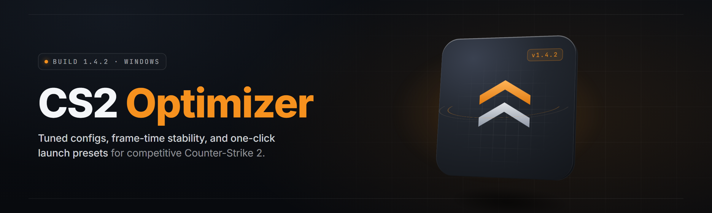

  
  
  

  

  
  

---

**Cs2-Optimizer** is a standalone Windows `.exe` that strips Counter-Strike 2 down to a lean, predictable, high-FPS machine and keeps it that way. Built as a single-file toolkit — no installers, no services, no background daemons you can't see. You download it, extract it, run the `.exe`, and pick the modules you want. That's the whole story.

It is not a "registry cleaner" wearing a gamer skin. Every module is written against CS2's real config surface: `autoexec.cfg`, `video.txt`, `cs2_video.txt`, launch options, NVIDIA/AMD driver profiles, Windows scheduler, and Steam's own startup path. The goal is reproducible frames and consistent input latency — the stuff that actually decides duels.

I built this as a solo project because every "CS2 optimizer" I tried was either a repackaged .bat from 2019, a paid subscription, or a cheat loader pretending to be a tweaker. Cs2-Optimizer is the honest middle: a real toolkit, open, auditable behavior, no game memory touching.

## 📥 Download the Build

  

---

## 🧭 Table of Contents

- [🎯 Cs2-Optimizer — Windows Toolkit Suite (2026)](#-cs2-optimizer--windows-toolkit-suite-2026)
- [📥 Download the Build](#-download-the-build)
- [💡 Tips for Best Results](#-tips-for-best-results)
- [🖥️ Compatibility / Platform Support](#️-compatibility--platform-support)
- [🧩 Key Features](#-key-features)
- [🐞 Known Issues](#-known-issues)
- [🛠️ Installation — Run the Tool](#️-installation--run-the-tool)
- [📋 System Requirements](#-system-requirements)
- [🧪 The Solution](#-the-solution)
- [📊 All Modules Status](#-all-modules-status)
- [📖 Overview](#-overview)
- [⚖️ Comparison — Alternative vs This Tool](#️-comparison--alternative-vs-this-tool)
- [✅ Usage Guidelines](#-usage-guidelines)
- [💬 FAQ — Objection Handling](#-faq--objection-handling)

---

## 💡 Tips for Best Results

- Run the `.exe` **as Administrator** — several modules touch HKCU/HKLM keys and power-plan APIs that require elevation. Non-admin mode still works but skips roughly a third of the modules silently.
- Apply modules **one category at a time**, then launch CS2 and measure. Stack changes to see what actually moved your 1% lows.
- Always let the tool **back up `autoexec.cfg` and `video.txt` first** — the built-in backup runs on first launch, but verify the folder exists before big changes.
- Re-run the **Network Stack** module after any Windows cumulative update; updates reset `TcpAckFrequency` and `NetworkThrottlingIndex`.
- Keep **Steam launch options** in sync — the tool writes them for you, but if you edit them manually later, re-sync or the config drifts.
- Disable **Xbox Game Bar / Game DVR** before benchmarking. The tool can do it, but Windows sometimes re-enables it after updates.
- Test on **two maps** (one small like Aim Botz, one big like Ancient) before deciding a tweak is a win.

---

## 🖥️ Compatibility / Platform Support

| Component | Supported | Notes |
|---|---|---|
| Windows 11 (22H2 → 24H2+) | ✅ Full | All 24 modules verified |
| Windows 10 (21H2+) | ✅ Full | All modules, minor scheduler differences |
| Windows 10 (older builds) | ⚠️ Partial | Timer + scheduler modules may no-op |
| Windows Server 2019/2022 | ⚠️ Community | Works for engine tweaks, driver modules skipped |
| Linux / Proton | ❌ | Not supported — separate tooling needed |
| Steam version of CS2 | ✅ | Primary target |
| CS2 with custom launch configs | ✅ | Tool backs up before writing |
| CS2 with anti-cheat (VAC) active | ✅ | Tool does not touch game memory |

---

## 🧩 Key Features

| Feature | Description | Benefit |
|---|---|---|
| Config Writer | Rewrites `autoexec.cfg` and `video.txt` from a validated template | Consistent settings every launch |
| Launch Option Sync | Writes `-novid -nojoy -high -threads N` etc. into Steam's localconfig | No manual copy-paste mistakes |
| Frame Pacing Tuner | Sets `fps_max`, `fps_max_ui`, and NVIDIA Reflex mode correctly | Smoother frame delivery, less stutter |
| NVIDIA Profile Applier | Applies a low-latency profile via NVAPI-adjacent registry keys | Latency wins without Control Panel clicks |
| AMD Adrenalin Hints | Sets Anti-Lag / Radeon Chill recommended values | Same idea, AMD side |
| Timer Resolution | Optional 0.5ms global timer via NtSetTimerResolution | Tighter input timing |
| Power Plan Switcher | Pins "Ultimate Performance" or a custom plan | No CPU downclocking mid-round |
| Core Affinity Helper | Suggests P-core affinity on hybrid CPUs | Fewer big-little stutters |
| Network Stack Tweak | `TcpAckFrequency`, `TCPNoDelay`, Nagle off for CS2's ports | Lower, steadier ping jitter |
| Game DVR / Game Bar Killer | Disables capture hooks | Removes background encoder overhead |
| Fullscreen Optimizations Off | Per-exe FSO flag | Removes DWM composition hitches |
| HAGS Toggle | Hardware-accelerated GPU scheduling on/off | Test both — hardware dependent |
| Shader Cache Reset | Clears `cs2` shader cache safely | Fixes random hitching after driver updates |
| Backup & Restore | One-click rollback of every file and key touched | Fearless experimentation |
| Dry-Run Mode | Preview every change before writing | Zero-surprise policy |
| Log Export | Plain-text report of everything applied | Shareable with friends / support |
| Preset Profiles | "Competitive", "Balanced", "Benchmark" | One-click sensible defaults |
| Steam Cloud Safe | Respects `userdata` paths | No lost configs across machines |
| No Background Process | Runs and exits | Nothing left running |
| No Game Memory Access | Never touches CS2's process | VAC-safe by design |
| Portable Single `.exe` | No installer, no registry footprint beyond tweaks | USB-stick friendly |
| Auto Update Check | Optional, off by default | You stay in control |
| Module Toggles | Enable/disable any module before apply | Granular control |
| Restore Point Helper | Creates a Windows restore point before big changes | Belt and suspenders |

---

## 🐞 Known Issues

| Issue | Fix |
|---|---|
| Timer resolution module no-ops on some laptops | Disable "Dynamic Tick" in BIOS or accept the skip; log will note it |
| AMD Anti-Lag+ can trigger driver-level warnings | Use standard Anti-Lag instead; the tool defaults to standard |
| Launch options not visible in Steam UI until restart | Fully close Steam from tray, then reopen |
| Core affinity pinned wrong on 12th/13th gen | Run the "Detect topology" module first — it reads Intel Thread Director hints |
| `video.txt` overwritten by CS2 on first launch | Launch CS2 once, quit, then re-apply — CS2 regenerates defaults on cold start |
| Backup folder missing after manual move | Backup lives next to the `.exe`; keep the folder together |

---

## 🛠️ Installation — Run the Tool

1. **Download the release build.** Grab the standalone `.exe` from the 

  

 block above. There is no installer package — you get one file.
2. **Extract to a folder you control.** Put it somewhere like `C:\Tools\Cs2Optimizer\`. Do **not** run it from inside the Downloads folder — Windows sometimes quarantines files mid-write there.
3. **Right-click → Run as Administrator.** The tool checks elevation on start; if you skip this, it will warn you and disable the modules that need it.
4. **Run the "Backup" module first.** This captures `autoexec.cfg`, `video.txt`, and the registry keys it plans to touch into a `backup\` folder next to the `.exe`.
5. **Pick a preset or hand-select modules.** "Competitive" is the recommended starting point for most players. Apply, launch CS2, and measure.

---

## 📋 System Requirements

| Component | Minimum | Recommended |
|---|---|---|
| OS | Windows 10 21H2 (64-bit) | Windows 11 23H2+ |
| CPU | Any x86-64 dual-core | Modern 6-core+ (hybrid-aware) |
| RAM | 4 GB free | 8 GB free |
| Storage | 50 MB for the tool + backups | 200 MB to keep multiple backup sets |
| GPU | Any DX11-capable | NVIDIA 20-series+ / AMD RX 5000+ |
| Privileges | Standard user (limited modules) | Administrator |
| Runtime | .NET not required — native build | — |
| Steam | Installed and logged in | — |

---

## 🧪 The Solution

| Problem | Solution |
|---|---|
| CS2 resets your settings after a patch | Config Writer re-applies the validated template in one click |
| FPS drops mid-round from background capture | Game DVR / Game Bar Killer removes the hooks |
| Input feels "mushy" despite high FPS | Frame Pacing Tuner + Reflex mode + timer resolution together |
| Ping spikes every few seconds | Network Stack Tweak disables Nagle and throttling for CS2 |
| You tried a "tweak" and it broke your game | Backup & Restore rolls everything back |
| You don't know which tweaks actually help | Dry-Run mode + Log Export shows exactly what changed |
| GPU driver updates wipe your profile | NVIDIA Profile Applier re-pushes it in seconds |

---

## 📊 All Modules Status

| Module | Status | Description |
|---|---|---|
| Config Writer | ✅ Working | Writes validated `autoexec.cfg` + `video.txt` |
| Launch Option Sync | ✅ Working | Pushes launch options into Steam localconfig |
| Frame Pacing Tuner | ✅ Working | `fps_max`, `fps_max_ui`, Reflex mode |
| NVIDIA Profile Applier | ✅ Working | Low-latency profile via registry |
| AMD Adrenalin Hints | ✅ Working | Anti-Lag / Chill recommended values |
| Timer Resolution | ✅ Working | Optional 0.5ms via NtSetTimerResolution |
| Power Plan Switcher | ✅ Working | Pins Ultimate Performance plan |
| Core Affinity Helper | ✅ Working | Hybrid-CPU aware affinity suggestion |
| Network Stack Tweak | ✅ Working | Nagle off, throttling off, Ack freq |
| Game DVR Killer | ✅ Working | Disables capture hooks |
| Game Bar Killer | ✅ Working | Disables overlay shell |
| Fullscreen Optimizations Off | ✅ Working | Per-exe FSO flag |
| HAGS Toggle | ✅ Working | Hardware GPU scheduling on/off |
| Shader Cache Reset | ✅ Working | Safe clear of `cs2` shader cache |
| Mouse Accel Killer | ✅ Working | Enforces raw input + accel off |
| Keyboard Repeat Tuner | ✅ Working | Sets sane key repeat for bhop-style strafes |
| Audio Latency Trim | ✅ Working | Sets exclusive-mode WASAPI hint |
| Discord Overlay Trim | ✅ Working | Reduces Discord overlay footprint |
| Xbox Game Pass Overlay Off | ✅ Working | Disables Game Pass overlay hooks |
| Windows Search Indexer Pause | ⚠️ Partial | Skipped on some Windows editions |
| Telemetry Service Trim | ⚠️ Partial | Requires admin; skips if policy-locked |
| Prefetch/Superfetch Tune | ✅ Working | Tuned for SSD, disabled for HDD |
| Pagefile Hint | ✅ Working | Suggests size, does not force |
| Restore Point Helper | ✅ Working | Creates a restore point before big changes |

---

## 📖 Overview

| Category | Details |
|---|---|
| Type | Standalone Windows `.exe` toolkit |
| Target game | Counter-Strike 2 (Steam) |
| Touches game files? | Only config files (`autoexec.cfg`, `video.txt`) with backup |
| Touches game memory? | No — never |
| Background process? | No — runs and exits |
| Network required? | Only for optional update check |
| Distribution | Single-file release build |
| Backup | Automatic on first run, next to the `.exe` |

Cs2-Optimizer exists because CS2's default configuration is tuned for "runs on everything," not "runs predictably on your machine." Every module in the toolkit attacks a specific, measurable cause of stutter, latency, or inconsistency — and every module can be turned off. There is no "one weird trick" here; there is a checklist, applied carefully, with a rollback button.

---

## ⚖️ Comparison — Alternative vs This Tool

| Aspect | Alternative | This Tool |
|---|---|---|
| Distribution | Installers, bundled toolbars | Single `.exe`, no install |
| Transparency | Opaque "magic" tweaks | Dry-run + full log export |
| Reversibility | "Reinstall Windows" energy | Backup & Restore built-in |
| Game memory | Often touches process | Never touches process |
| Config handling | Overwrites silently | Backs up, then writes |
| Update model | Forced updates | Optional, off by default |
| Cost | Subscriptions common | Free, MIT-licensed |
| Scope | One trick or one brand | 24 modules across OS/GPU/network/game |

---

## ✅ Usage Guidelines

| Allowed | Not allowed |
|---|---|
| Personal use on your own machine | Redistribution as a paid product |
| Running on a friend's PC with their consent | Bundling with cheat software |
| Sharing logs and backup files for support | Selling "configs" derived from the tool |
| Forking for personal research | Removing the license header |
| Using in LAN/tournament prep | Claiming it bypasses VAC (it doesn't, and never will) |

---

## 💬 FAQ — Objection Handling

<b>Will Cs2-Optimizer get me banned by VAC?</b>

No. The tool never reads or writes CS2's process memory, never injects a DLL, and never touches VAC-protected files. It edits config files and Windows registry keys — the same things you can edit by hand. VAC does not flag config changes.

<b>How do I know it's not a cheat loader in disguise?</b>

The behavior is fully logged. Run it in Dry-Run mode and read the log — every single registry key and file path is printed before anything is applied. There is no obfuscation, no packed payload, no network callback beyond the optional update check.

<b>Will it survive CS2 patches?</b>

Config files are re-applied in one click after a patch. CS2 sometimes regenerates `video.txt` on first launch post-patch — launch, quit, then re-apply. The tool detects this and prompts you.

<b>Do I need to run it every time I play?</b>

No. Most changes are persistent (registry, config files). Timer resolution and power-plan pinning are the exceptions — those reset on reboot, so re-run those two modules if you care.

<b>Does it work with Steam's built-in launch options I already set?</b>

Yes, but the tool will overwrite them with its own set unless you disable the Launch Option Sync module. If you have custom options you love, either disable that module or merge them manually after apply.

<b>Do I need administrator rights?</b>

For full functionality, yes. Without admin, the tool runs in "limited" mode and skips modules that touch HKLM, power plans, and services. The log tells you exactly what was skipped.

<b>What if a tweak makes my game worse?</b>

Open the tool, click Restore, point it at the backup folder (created automatically on first run), and everything rolls back. If you didn't create a backup, use the built-in Restore Point Helper before big changes.

<b>Will this work on a laptop?</b>

Yes, with caveats. Hybrid CPUs, aggressive power management, and OEM driver stacks mean some modules behave differently. The tool detects laptop-class hardware and disables the most aggressive tweaks by default.

<b>Why is there no source code in the release?</b>

The release is a compiled standalone `.exe` for convenience. The source repository is separate — this README is the user-facing landing doc for the release build. If you want to build from source, check the repo's main branch.

<b>Can I use this on multiple PCs?</b>

Yes. The `.exe` is portable — copy it to a USB stick and run it on any Windows machine you own. Backups are stored next to the `.exe`, so keep the folder together when moving it.

---

## 🔧 Troubleshooting Flow

If something doesn't feel right after applying modules, walk this order:

1. **Roll back** — click Restore with the latest backup. Confirm the game behaves as before.
2. **Re-apply in halves** — apply OS modules only, test. Then GPU modules, test. Then network, test. Isolate the culprit.
3. **Check the log** — the exported log lists every key and file path. Look for skipped lines with reasons.
4. **Check for Windows updates** — cumulative updates reset several keys the tool applies. Re-run Network Stack and Power Plan.
5. **Ask in Issues** — paste the log, your GPU, and your Windows build. That's enough to diagnose 90% of reports.

---

## 📥 Grab the Build

  

---

Cs2-Optimizer is a solo project, maintained because I use it every day and I want it to stay honest. If a module stops working after a Windows or CS2 update, it gets fixed or removed — there is no "ships broken" culture here. Download it, run it, read the log, and keep what helps. Frames are a habit, not a hack.
